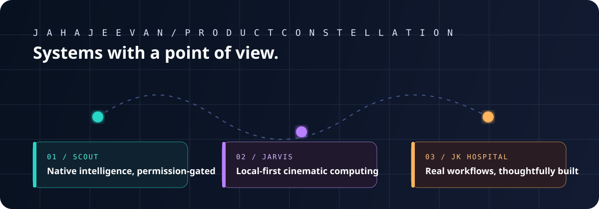

<p align="center">
  
</p>

# Hey, I’m Jahajeevan 👋

I’m a full-stack product engineer who turns ambitious ideas into working systems—especially where **AI, native experiences, privacy, and real-world workflows** meet.

I care about the details that make software trustworthy: a clear permission boundary, a fast and thoughtful interface, and a system that still makes sense after the demo is over.

## Flagship builds

| Project | What makes it interesting |
| :-- | :-- |
| [Scout](https://github.com/jahajeevan/Scout) | Native macOS intelligence with wake word, screen vision, RAG, voice streaming, persistent memory, multi-agent orchestration, and a three-tier permission gate. |
| [J.A.R.V.I.S.](https://github.com/jahajeevan/jarvis) | A local-first macOS assistant combining a cinematic Three.js interface, offline voice pipeline, gestures, private memory, and opt-in computer actions. |
| [JK Hospital](https://github.com/jahajeevan/jk-hospital) | A full-stack appointment, token-queue, payment, invoice, refund, and administration platform designed around real operations. |

## My build philosophy

```text
intelligence without permission is not assistance
beautiful interfaces still need useful workflows
local-first is a product decision, not just a feature
```

## Working across the stack

`TypeScript` · `React` · `Next.js` · `Node.js` · `Python` · `FastAPI` · `Three.js` · `macOS` · `SQLite` · `Supabase` · `MongoDB` · `Docker`

## More selected work

- [JeevVPN](https://github.com/jahajeevan/JeevVPN) — Flutter Android VPN client with release automation and in-app updates
- [Simbells Wedding & Events](https://github.com/jahajeevan/simbells-wedding-events) — production event website with booking journeys and administration
- [Hearth & Bloom Designs](https://github.com/jahajeevan/hearth-bloom-designs) — interior-design portfolio experience

---

<p align="center"><i>Build things that earn trust.</i></p>
