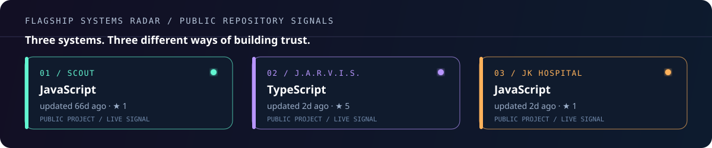
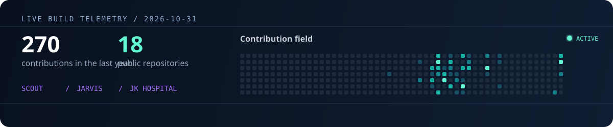

<p align="center">
  
</p>

<p align="center">
  <a href="https://github.com/jahajeevan?tab=followers"></a>
  <a href="https://github.com/jahajeevan"></a>
  
</p>

---

## ⚡ What I build

I build software at the intersection of **AI agents**, **native macOS experiences**, and **real-world products**. I care most about the difficult parts: useful workflows, sensible permission boundaries, and software that earns trust beyond the demo.

**Flagship work:** [Scout](https://github.com/jahajeevan/Scout) · [J.A.R.V.I.S.](https://github.com/jahajeevan/jarvis) · [JK Hospital](https://github.com/jahajeevan/jk-hospital)

<p align="center">
  
</p>

## ◉ JARVIS / live interface

<p align="center">
  <a href="https://github.com/jahajeevan/jarvis/blob/main/docs/assets/demo/jarvis-live-demo.mp4">
    
  </a>
</p>

<p align="center"><sub>Local-first macOS assistant · voice, private memory, real-time visual states · <a href="https://github.com/jahajeevan/jarvis/blob/main/docs/assets/demo/jarvis-live-demo.mp4">watch the full demo ↗</a></sub></p>

## 🛠️ Technology I use

<p align="center">
  
</p>

<p align="center"><code>Ollama</code> · <code>NVIDIA NIM</code> · <code>Whisper</code> · <code>Vosk</code> · <code>Kokoro TTS</code> · <code>WebSocket streaming</code> · <code>GitHub Actions</code></p>

## 📊 GitHub signals

<p align="center">
  
  
</p>

<p align="center">
  
</p>

<p align="center">
  
</p>

## 🐍 Contribution trail

<p align="center">
  
</p>

## 🎯 Currently exploring

```text
▸ Agent orchestration with real permission boundaries
▸ Voice-first and local-first desktop computing
▸ Product systems that replace busywork with calm, clear workflows
```

## 🌐 Selected work

- [JeevVPN](https://github.com/jahajeevan/JeevVPN) — Flutter Android VPN client with release automation and in-app updates
- [Simbells Wedding & Events](https://github.com/jahajeevan/simbells-wedding-events) — production event website with booking journeys and administration
- [Hearth & Bloom Designs](https://github.com/jahajeevan/hearth-bloom-designs) — interior-design portfolio experience

<p align="center"><b>Make it useful. Make it beautiful. Make it trustworthy.</b></p>
